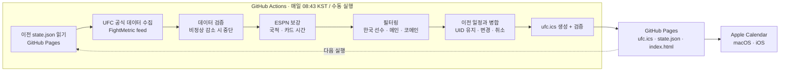

# ufc-calendar

UFC 경기 중 **한국 선수 출전 경기**와 **메인/코메인 이벤트**를 골라 Apple Calendar에서 구독할 수 있는 ICS 캘린더로 만들어 주는 프로젝트입니다. GitHub Actions가 매일 일정을 다시 수집하고, GitHub Pages가 고정 URL로 `ufc.ics`를 배포합니다. 별도 서버나 유료 API는 쓰지 않습니다.

```
구독 URL: https://jin-uu.github.io/ufc-calendar/ufc.ics
```

캘린더에는 이런 일정이 들어갑니다(시간은 모두 한국 시간).

| 일정 제목 | 조건 | 시작 시간 |
|---|---|---|
| `🇰🇷 UFC \| Cody Chovancek vs SuYoung You` | 한국 선수 출전 | 해당 경기가 속한 카드(메인/프릴림/얼리 프릴림)의 시작 시간 |
| `🥊 UFC Main \| Joaquin Buckley vs Mike Malott` | 메인 이벤트 | 메인 카드 시작 시간 |
| `🥊 UFC Co-Main \| Erin Blanchfield vs Jasmine Jasudavicius` | 코메인 이벤트 | 메인 카드 시작 시간 |
| `🇰🇷 UFC Main \| …` / `🇰🇷 UFC Co-Main \| …` | 한국 선수가 메인/코메인에 출전 | 메인 카드 시작 시간 |
| `🇰🇷 Road to UFC \| …` / `🇰🇷 DWCS \| …` | Road to UFC·Contender Series의 한국 선수 경기 | 카드 시작 시간 |

UFC 넘버링 대회, Fight Night, Noche UFC 같은 UFC 대회에는 위 세 조건이 모두 적용됩니다. Road to UFC와 Dana White's Contender Series는 한국 선수 경기만 등록합니다. 한 경기가 여러 조건에 해당해도 일정은 하나만 만들어집니다.

---

## 1. 전체 아키텍처



| 모듈 | 역할 |
|---|---|
| [`scraper.py`](src/ufc_calendar/scraper.py) | HTTP(Timeout/Retry), FightMetric 대회 탐색·파싱, ESPN 국적/카드 시간 매칭 |
| [`models.py`](src/ufc_calendar/models.py) | `Event`, `Fight`, `Fighter` 데이터 클래스 |
| [`filter.py`](src/ufc_calendar/filter.py) | 한국 선수 판별, 메인/코메인 판별, 등록 대상 선택 |
| [`schedule.py`](src/ufc_calendar/schedule.py) | 시각 파싱, 한국 시간 변환, 카드별 시작 시간 선택 |
| [`state.py`](src/ufc_calendar/state.py) | 실행 간 상태: UID 유지, SEQUENCE, 취소·삭제 처리 |
| [`ics.py`](src/ufc_calendar/ics.py) | 제목/설명 작성, RFC 5545 ICS 생성 및 검증 |
| [`main.py`](src/ufc_calendar/main.py) | CLI, 전체 흐름, 실패 처리, 출력 파일 작성 |

> 표준 라이브러리 `calendar` 모듈과 이름이 겹치지 않도록 ICS 모듈 이름은 `calendar.py` 대신 `ics.py`로 했습니다.

출력 파일(`output/` 또는 Actions의 `public/`):

- `ufc.ics`: 구독용 캘린더
- `state.json`: 다음 실행이 읽는 상태(일정 목록, UID, 대회 스냅샷, 국적 캐시). 공개된 경기 정보만 들어 있고 비밀정보는 없습니다.
- `index.html`: 구독 링크와 예정 경기 목록이 있는 안내 페이지

이전 상태를 저장소에 커밋하지 않고 GitHub Pages에서 다시 읽어오기 때문에, 워크플로에 저장소 쓰기 권한이 필요 없습니다.

---

## 2. 데이터 소스 및 선정 이유

구현 전에 조사한 후보와 결론입니다.

| 소스 | 무료 | 국적 | 메인/코메인 | 카드 시간 | GitHub Actions 수집 | 판단 |
|---|---|---|---|---|---|---|
| **UFC 공식 데이터 feed** (FightMetric, `d29dxerjsp82wz.cloudfront.net/api/v3/event/live/{id}.json`) | ✅ 키 없음 | △ 출생지·활동지만 | ✅ 공식 경기 순서 | ✅ 카드별 시작 시각 | ✅ CloudFront JSON | **주 소스** |
| **ESPN scoreboard JSON** (`site.api.espn.com/.../mma/ufc/scoreboard`) | ✅ 키 없음 | ✅ 국기(UFC.com 표기와 같음) | ✗ 명시 없음 | ✅ 경기별 카드 시각 | ✅ | **보조 소스** |
| ufc.com HTML | ✅ | ✅ | ✅ | ✅ | ✗ 일반 HTTP 요청은 403(봇 차단) | 차단 우회는 하지 않으므로 제외 |
| UFCStats / Tapology / Sherdog | ✅ | ✗ 또는 이용약관상 스크래핑 제한 | – | ✗ | – | 제외 |

**UFC 공식 데이터 feed (주 소스).** ufc.com과 UFC 앱이 대진표·라이브 데이터를 보여줄 때 읽는 JSON입니다. 공개 CDN에서 인증 없이 받을 수 있고, 다음 정보가 구조화되어 있습니다.

- 고유 `FightId`: 일정 UID로 사용
- `FightOrder`: 1이 메인 이벤트, 2가 코메인
- `CardSegment`(Main / Prelims1 / Prelims2)와 카드별 시작 시각(UTC)
- 체급, 타이틀전 여부, 장소

**ESPN (보조 소스).** 공식 feed에는 국적 필드가 없고 출생지(`Born`)와 활동지(`FightingOutOf`)만 있습니다. 예를 들어 Mike Malott은 출생지가 USA지만 캐나다 선수입니다. ESPN의 국기 정보는 UFC.com 대진표에 표시되는 국적과 같아서 국적 판별에 우선 사용합니다. 공식 feed가 아직 카드를 배정하지 않은 경기(대진 발표 직후에 흔함)는 ESPN의 경기별 카드 시각으로 시간을 채웁니다. 이 시각이 UFC.com 표기와 일치하는 것도 확인했습니다. ESPN 요청은 실행당 1회(날짜 범위 조회)입니다.

**한계와 대응**

- 두 소스 모두 공개 문서가 없는 비공식 엔드포인트라 예고 없이 바뀔 수 있습니다. 그래서 응답 구조를 검증하고, 이상하면 배포를 중단합니다. 하루 수십 건 수준의 개인용 저빈도 요청만 보냅니다.
- 공식 feed에는 대회 목록 API가 없습니다. 대회 ID가 발표 순서대로 증가한다는 점을 이용해, 직전 실행 기준 가장 작은 예정 대회 ID부터 위로 조회하고 사용되지 않은 ID가 10번 연속 나오면 멈춥니다. 하루 약 30~40건, 요청 간 0.25초 간격입니다.
- ESPN을 사용할 수 없으면 이전에 ESPN에서 받은 국적(캐시)을 쓰고, 그것도 없으면 공식 feed의 출생국으로 판별합니다. 이름만 보고 국적을 추측하지는 않습니다.

---

## 3. 로컬 실행 방법

요구사항: macOS 또는 Linux, [uv](https://docs.astral.sh/uv/) (Python 3.12는 uv가 자동으로 설치).

```bash
git clone https://github.com/Jin-uu/ufc-calendar.git
cd ufc-calendar
uv sync
uv run ufc-calendar            # output/ufc.ics, output/state.json, output/index.html 생성
```

자주 쓰는 옵션:

| 옵션 | 설명 |
|---|---|
| `--output-dir DIR` | 출력 폴더 (기본 `output`) |
| `--previous-state PATH_OR_URL` | 이전 `state.json` (기본 `<output-dir>/state.json`) |
| `--days N` | 수집 기간 (기본 90일) |
| `--allow-drop` | 대회·일정이 대량으로 사라져도 강제로 생성 |
| `--seed-event-id N` | 이전 상태가 없을 때 탐색을 시작할 대회 ID (기본 1330) |
| `-v` | 디버그 로그 |

같은 폴더에서 다시 실행하면 이전 결과를 읽어 UID를 유지합니다. 데이터가 바뀌지 않았다면 `ufc.ics`도 바이트 단위로 같게 생성됩니다. 생성된 파일은 macOS Calendar에서 `파일 → 가져오기`로 미리 확인할 수 있습니다.

---

## 4. 테스트 실행 방법

```bash
uv run pytest
```

테스트는 실제 응답을 줄여 저장한 fixture(`tests/fixtures/`)와 가짜 HTTP 세션을 사용하므로 외부 네트워크가 필요 없습니다.

| 파일 | 내용 |
|---|---|
| `test_scraper.py` | 정상 응답 파싱, 일부 필드 누락, HTTP 오류·네트워크 오류·잘못된 JSON, 대진 미확정, ID 탐색, 이전 스냅샷 대체, ESPN 국적 매칭과 대체 순서 |
| `test_filter.py` | 한국 선수 포함, 일반 언더카드 제외, 메인/코메인 포함, 한국 선수 메인/코메인 중복 제거, 국적 누락, 경기 순서 불명확, RTU/DWCS |
| `test_schedule.py` | UTC→Asia/Seoul 변환, 미국 서머타임 전후, 카드별 시작 시간, 시작 시간 누락 시 대체·종일 처리 |
| `test_ics.py` | 유효한 ICS, 특수문자·줄바꿈, 한국어·이모지와 75옥텟 줄 접기, 결정적 출력, 검증 실패 |
| `test_state.py` | UID 유지(동일 경기·시간 변경·날짜 변경·선수 교체·경기 재생성), 중복 방지, 취소·복구·삭제, 지난 일정 보관 |
| `test_main.py` | 전체 흐름, 수집 실패 시 기존 파일 보존, 비정상 감소 시 중단, ESPN 장애, 원격 이전 상태 |

---

## 5. GitHub Actions 동작 방식

워크플로: [`.github/workflows/update-calendar.yml`](.github/workflows/update-calendar.yml)

- **자동 실행**: 매일 23:43 UTC(08:43 KST). GitHub 스케줄 실행은 보통 몇 분에서 수십 분 늦게 시작하고, 정각 실행이 특히 많이 밀립니다. 그래서 정각을 피해 조금 일찍 예약했고, 실제 갱신은 대개 오전 9시 전후에 이뤄집니다.
- **수동 실행**: Actions 탭 → *Update UFC calendar* → *Run workflow*. 대회 취소가 실제로 대량 발생해서 안전장치에 걸렸다면 `allow_drop`을 켜고 실행합니다.

실행 순서:

1. Python/uv 준비, 의존성 설치(`uv sync --locked`)
2. 테스트 실행(`pytest`). 실패하면 배포하지 않습니다.
3. 이전 `state.json`을 GitHub Pages에서 읽기. 첫 배포라 404면 새로 시작합니다.
4. UFC 공식 데이터 수집 → 검증 → ESPN 보강 → 필터링 → ICS 생성
5. 생성한 ICS를 다시 파싱해서 검증(필수 속성, UID 중복, 줄 길이, 시간 순서)
6. `actions/upload-pages-artifact` → `actions/deploy-pages`로 배포

**실패 처리 원칙**

| 상황 | 동작 |
|---|---|
| 네트워크/HTTP 오류, 응답 구조 이상 | 요청마다 Timeout 5/20초, 429·5xx는 최대 3회 재시도(백오프, `Retry-After` 존중). 그래도 실패하면 이전 실행에서 알던 대회는 직전 스냅샷을 쓰고, 그 외에는 실행을 실패 처리하고 배포하지 않습니다. |
| ESPN 장애 | 경고만 남기고 계속 진행합니다(캐시된 국적 → 공식 출생국 순으로 대체). |
| 직전 실행의 예정 대회가 절반 넘게 사라짐 | 배포 중단(`allow_drop`으로 무시 가능) |
| 예정 일정 중 절반 넘게(3건 이상) 한 번에 취소됨 | 배포 중단(`allow_drop`으로 무시 가능) |
| ICS 검증 실패 | 배포 중단 |
| 수집은 성공했지만 예정 대회가 없음 | 정상으로 보고 배포합니다(지난 경기 기록은 유지). |

실행이 실패하면 배포 단계가 실행되지 않으므로, GitHub Pages에는 마지막으로 성공한 `ufc.ics`가 그대로 남습니다. 원인은 Actions 로그와 `::error` 주석에서 확인할 수 있고, 성공한 실행은 Job Summary에 변경 건수와 예정 일정 목록이 표시됩니다.

**권한**: 워크플로 전체는 `contents: read`, 배포 job만 `pages: write`와 `id-token: write`를 받습니다. Personal Access Token은 쓰지 않습니다.

---

## 6. GitHub Pages 설정 방법

한 번만 하면 됩니다.

1. 저장소 → **Settings → Pages**
2. **Build and deployment → Source**를 **GitHub Actions**로 선택
3. **Actions** 탭 → **Update UFC calendar** → **Run workflow**로 첫 배포
4. 배포가 끝나면 아래 주소가 열리는지 확인합니다.
   - 안내 페이지: `https://jin-uu.github.io/ufc-calendar/`
   - 캘린더: `https://jin-uu.github.io/ufc-calendar/ufc.ics`

이후에는 매일 자동으로 갱신되고, URL은 바뀌지 않습니다. 무료 플랜에서는 GitHub Pages를 쓰려면 저장소가 public이어야 합니다.

---

## 7. Apple Calendar 구독 방법

### macOS (Calendar 앱)

1. Calendar 앱 → 메뉴 **파일 → 새로운 캘린더 구독…**
2. URL에 `https://jin-uu.github.io/ufc-calendar/ufc.ics`를 입력하고 **구독**
3. 설정 화면에서:
   - **위치: iCloud**를 고르면 같은 Apple ID를 쓰는 iPhone에도 자동으로 나타납니다(이 경우 iOS에서 따로 구독할 필요가 없습니다).
   - **자동 업데이트: 매일**(또는 매시간)
   - **알림 제거**는 취향에 맞게 설정합니다. 이 캘린더는 알림을 포함하지 않으므로 필요하면 Calendar 앱에서 기본 알림을 따로 지정하세요.
4. **확인**

### iOS / iPadOS

macOS에서 iCloud 위치로 구독했다면 이 단계는 필요 없습니다.

- **방법 A (간단)**: iPhone Safari에서 `https://jin-uu.github.io/ufc-calendar/`를 열고 **Apple 캘린더에서 구독** 버튼을 누른 뒤 **구독**을 선택합니다.
- **방법 B (설정 앱)**:
  1. iOS 18 이상: **설정 → 앱 → 캘린더 → 캘린더 계정 → 계정 추가**
     (iOS 17 이하: **설정 → 캘린더 → 계정 → 계정 추가**)
  2. **기타 → 구독 캘린더 추가**
  3. 서버에 `https://jin-uu.github.io/ufc-calendar/ufc.ics`를 입력 → **다음** → **저장**

구독 캘린더는 읽기 전용입니다. 갱신 주기는 Apple 기기가 결정하며, 특히 iCloud에 둔 구독은 반영까지 몇 시간이 걸릴 수 있습니다.

---

## 8. 일정 갱신 및 취소 처리 방식

**UID**: 일정 UID는 공식 feed의 고유 `FightId`로 만듭니다(`fight-13132@ufc-calendar`). 선수 이름이나 시간은 UID에 쓰지 않습니다. 이전 실행의 `state.json`에 일정별 UID와 연결된 FightId 목록이 남아 있어서, 같은 경기는 계속 같은 UID를 씁니다.

| 변경 | 처리 |
|---|---|
| 경기 시간 변경 / 대회 날짜 변경 | 같은 UID로 시간 수정, `SEQUENCE` 증가, `LAST-MODIFIED` 갱신 |
| 선수 교체(같은 FightId 유지) | 같은 UID로 제목·설명 수정 |
| 선수 교체(새 FightId로 다시 만들어짐) | 같은 대회에서 사라진 경기와 선수가 한 명 이상 겹치면 같은 경기로 보고 기존 UID를 이어받음 |
| 경기 취소 / 대진에서 빠짐 / 대회 삭제 | 제목 앞에 `❌ 취소 \|`를 붙이고 `STATUS:CANCELLED`로 표시. 원래 일정 하루 뒤에 캘린더에서 제거 |
| 한국 선수가 빠지고 다른 선수로 교체(같은 FightId) | 한국 선수 경기가 취소된 것으로 보고 취소 표시 |
| 경기는 남았지만 조건에서 벗어남(예: 코메인 아님) | 일정 삭제 |
| 경기 종료 | 마지막 상태 그대로 1년간 보관(결과는 표시하지 않음) |

같은 데이터를 여러 번 처리해도 일정은 경기당 하나이고, 내용이 바뀌지 않았으면 ICS 파일도 바뀌지 않습니다.

**시간**: 개별 경기의 정확한 시작 시간은 미리 확정되지 않습니다. 그래서 다음 순서로 시간을 정하고, 어떤 기준인지 일정 설명에 적습니다. 일정 길이는 카드 시작을 표시하는 용도로 1시간입니다.

1. 공식 feed의 해당 카드(메인/프릴림/얼리 프릴림) 시작 시각
2. 같은 카드의 다른 경기에 공개된 공식 시작 시각
3. ESPN이 공개한 이 경기의 카드 시작 시각(공식 카드 배정 전)
4. 대회 시작 시각(공식 feed에 현지 시간대가 있을 때만 신뢰). 설명에 "대체 시간"이라고 명시
5. 위 정보가 모두 없으면 날짜만 있는 종일 일정

원본 시각은 모두 UTC(오프셋 포함)이고 `Asia/Seoul`로 변환합니다. 따라서 미국 서머타임 전후(예: 라스베이거스 17:00 → 10/31은 09:00 KST, 11/7은 10:00 KST)도 정확하게 처리됩니다. ICS에는 `TZID=Asia/Seoul`과 `VTIMEZONE`이 들어갑니다.

**메인/코메인 판별**: 공식 경기 순서 1번이 메인 이벤트, 2번이 코메인입니다. 순서가 중복되거나 없으면 지정하지 않습니다. 코메인은 메인 카드에 있어야 합니다. 공식 feed가 아직 카드를 배정하지 않았다면, ESPN이 대회를 여러 카드 시각으로 나눠 두었고 이 경기가 메인 이벤트와 같은 시각일 때만 코메인으로 인정합니다.

---

## 9. 알려진 한계점

- **비공식 API 의존**: UFC 공식 feed와 ESPN 모두 공개 문서가 없는 엔드포인트입니다. 형식이 바뀌면 수집이 실패할 수 있습니다. 이때 기존 캘린더는 유지되지만 갱신은 멈추므로, Actions 실패 알림을 확인해야 합니다.
- **대회 탐색 방식**: 공식 feed에 대회 목록이 없어 ID를 순서대로 조회합니다. ID 부여 방식이 크게 바뀌면 `--seed-event-id` 조정이 필요할 수 있습니다.
- **국적**: ESPN 국기는 선수가 대표하는 국가 기준입니다. ESPN에 없는 선수(예: 일부 Road to UFC 선수)는 출생국으로 판별하므로 이중국적이나 해외 출생 선수는 틀릴 수 있습니다. 판별할 수 없는 선수는 로그에 남기고 한국 선수로 취급하지 않습니다.
- **카드 배정 지연**: 대진 발표 직후에는 카드 구분이 비어 있는 경우가 많습니다. 이때 시간은 ESPN 기준이고, 코메인은 근거가 확인될 때까지 등록되지 않을 수 있습니다.
- **공식 URL**: 넘버링 대회는 `ufc.com/event/ufc-N`, 그 외 UFC 대회는 현지 날짜로 만든 `ufc.com/event/ufc-fight-night-<월>-<일>-<연도>` 형식입니다. 드물게 실제 주소와 다를 수 있고, Road to UFC·DWCS는 UFC 이벤트 목록 페이지로 연결됩니다.
- **갱신 지연**: GitHub 스케줄 지연, GitHub Pages CDN 캐시(최대 약 10분), Apple Calendar 자체 갱신 주기 때문에 실제 변경이 캘린더에 보이기까지 시간이 걸립니다.
- **스케줄 자동 비활성화**: GitHub은 public 저장소에서 60일 동안 저장소 활동(커밋 등)이 없으면 스케줄 워크플로를 자동으로 끕니다. 그렇게 되면 Actions 탭에서 *Enable workflow*를 누르거나 커밋을 하나 푸시하면 다시 동작합니다. 저장소 쓰기 권한을 주지 않기 위해 자동 커밋 같은 우회는 넣지 않았습니다.
- **공개 데이터**: `state.json`은 GitHub Pages에 공개됩니다. 공개 경기 정보만 들어 있습니다.
