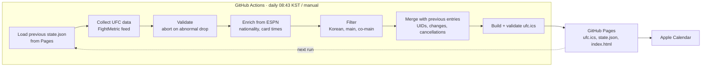

# ufc-calendar

Builds an iCalendar feed of UFC bouts featuring Korean fighters, plus every main and co-main event, for subscription in Apple Calendar. GitHub Actions refreshes the data daily and GitHub Pages serves the feed at a fixed URL. No server or paid API is used.

```
https://jin-uu.github.io/ufc-calendar/ufc.ics
```

| Title | Condition | Start time (KST) |
|---|---|---|
| `🇰🇷 UFC \| A vs B` | Korean fighter | Start of the bout's card (main / prelims / early prelims) |
| `🥊 UFC Main \| A vs B` | Main event | Main card start |
| `🥊 UFC Co-Main \| A vs B` | Co-main event | Main card start |
| `🇰🇷 UFC Main \| …`, `🇰🇷 UFC Co-Main \| …` | Korean fighter in main / co-main | Main card start |
| `🇰🇷 Road to UFC \| …`, `🇰🇷 DWCS \| …` | Korean fighter at Road to UFC / Contender Series | Card start |

All three conditions apply to UFC events (numbered, Fight Night, Noche UFC). Road to UFC and DWCS contribute Korean bouts only. A bout matching several conditions produces one entry.

## 1. Architecture



| Module | Responsibility |
|---|---|
| [`scraper.py`](src/ufc_calendar/scraper.py) | HTTP with timeout/retry, FightMetric discovery and parsing, ESPN matching |
| [`models.py`](src/ufc_calendar/models.py) | `Event`, `Fight`, `Fighter` |
| [`filter.py`](src/ufc_calendar/filter.py) | Korean fighter, main and co-main detection |
| [`schedule.py`](src/ufc_calendar/schedule.py) | Timestamp parsing, KST conversion, card start selection |
| [`state.py`](src/ufc_calendar/state.py) | State across runs: UIDs, SEQUENCE, cancellation, removal |
| [`ics.py`](src/ufc_calendar/ics.py) | Summary/description text, RFC 5545 output and validation |
| [`main.py`](src/ufc_calendar/main.py) | CLI, pipeline, failure handling, output |

The ICS module is named `ics.py` to avoid shadowing the standard library `calendar` module.

Output (`output/` locally, `public/` in Actions):

- `ufc.ics`: subscription feed.
- `state.json`: state read by the next run (entries, UIDs, event snapshots, nationality cache). Public fight data only.
- `index.html`: landing page with the subscription link and upcoming entries.

The previous state is read back from GitHub Pages, so the workflow needs no repository write access.

## 2. Data sources

| Source | Free | Nationality | Main/co-main | Card times | Usable from Actions | Use |
|---|---|---|---|---|---|---|
| UFC FightMetric feed (`d29dxerjsp82wz.cloudfront.net/api/v3/event/live/{id}.json`) | Yes, no key | Birthplace only | Official bout order | Per card | Yes | Primary |
| ESPN scoreboard JSON (`site.api.espn.com/.../mma/ufc/scoreboard`) | Yes, no key | Flag (matches ufc.com) | Not explicit | Per bout | Yes | Secondary |
| ufc.com HTML | Yes | Yes | Yes | Yes | No (403 bot protection) | Excluded; not bypassed |
| UFCStats / Tapology / Sherdog | — | Missing or ToS-restricted | — | No | — | Excluded |

**FightMetric (primary).** The JSON behind ufc.com and the UFC app. Provides a unique `FightId` (used for UIDs), `FightOrder` (1 = main event, 2 = co-main), `CardSegment` (Main / Prelims1 / Prelims2) with UTC start times, weight class, title status and venue.

**ESPN (secondary).** FightMetric has no nationality field, only `Born` and `FightingOutOf` (e.g. Mike Malott: born USA, Canadian). ESPN flags match ufc.com and take precedence. ESPN per-bout card times fill bouts that FightMetric has not yet assigned to a card. One ESPN request per run.

**Limitations**

- Both endpoints are undocumented and may change without notice. Responses are validated; anomalies abort deployment. Request volume is low (tens per day).
- FightMetric has no event listing. Event ids are sequential, so the scan starts at the smallest upcoming id from the previous run and stops after 10 consecutive unused ids (about 30–40 requests per run, 0.25 s apart).
- Nationality fallback order: ESPN → cached ESPN value → FightMetric birthplace. Names are never used to infer nationality.

## 3. Local usage

Requires macOS or Linux and [uv](https://docs.astral.sh/uv/). uv installs Python 3.12.

```bash
git clone https://github.com/Jin-uu/ufc-calendar.git
cd ufc-calendar
uv sync
uv run ufc-calendar
```

| Option | Description |
|---|---|
| `--output-dir DIR` | Output directory (default `output`) |
| `--previous-state PATH_OR_URL` | Previous `state.json` (default `<output-dir>/state.json`) |
| `--days N` | Collection window (default 90) |
| `--allow-drop` | Publish despite mass disappearance of events or entries |
| `--seed-event-id N` | First event id to scan without previous state (default 1330) |
| `-v` | Debug logging |

Re-running in the same directory keeps UIDs. Unchanged data yields a byte-identical `ufc.ics`.

## 4. Tests

```bash
uv run pytest
```

Tests use trimmed real responses (`tests/fixtures/`) and a fake HTTP session; no network access is required.

| File | Coverage |
|---|---|
| `test_scraper.py` | Parsing, missing fields, HTTP/network/JSON errors, unconfirmed cards, id scan, snapshot fallback, ESPN matching |
| `test_filter.py` | Korean inclusion, undercard exclusion, main/co-main, deduplication, missing nationality, ambiguous order, RTU/DWCS |
| `test_schedule.py` | UTC → Asia/Seoul, US DST, per-card start, missing-time fallbacks |
| `test_ics.py` | Validity, escaping, newlines, Korean/emoji, 75-octet folding, determinism, validation errors |
| `test_state.py` | UID stability (same bout, time/date change, replacement, re-created bout), no duplicates, cancel/restore/remove, history |
| `test_main.py` | End-to-end, failure preserves output, abnormal-drop abort, ESPN outage, remote previous state |

## 5. GitHub Actions

Workflow: [`.github/workflows/update-calendar.yml`](.github/workflows/update-calendar.yml)

- Schedule: 23:43 UTC (08:43 KST). Scheduled runs often start late, so updates land around 09:00 KST.
- Manual: Actions → *Update UFC calendar* → *Run workflow*. Enable `allow_drop` to override the safety checks.

Steps: install dependencies (`uv sync --locked`) → `pytest` → load previous `state.json` from Pages (404 = first run) → collect, validate, enrich, filter, build → validate ICS → `actions/upload-pages-artifact` → `actions/deploy-pages`.

| Condition | Behavior |
|---|---|
| Network/HTTP error, malformed response | Timeout 5/20 s; up to 3 retries on 429/5xx with backoff. Known events fall back to the previous snapshot; otherwise the run fails without deploying. |
| ESPN unavailable | Warning; continues with cached / birthplace nationality. |
| More than half of previously upcoming events missing | Abort (override: `allow_drop`). |
| More than half (≥ 3) of upcoming entries cancelled at once | Abort (override: `allow_drop`). |
| ICS validation failure | Abort. |
| Collection succeeds with no upcoming events | Deploy; history retained. |

A failed run skips deployment, so Pages keeps the last good `ufc.ics`. Errors appear in the log and as `::error` annotations; successful runs write a job summary.

Permissions: `contents: read` for the workflow; `pages: write` and `id-token: write` for the deploy job only. No personal access token.

## 6. GitHub Pages setup

1. Repository → Settings → Pages.
2. Build and deployment → Source: **GitHub Actions**.
3. Actions → *Update UFC calendar* → *Run workflow*.
4. Verify `https://jin-uu.github.io/ufc-calendar/` and `https://jin-uu.github.io/ufc-calendar/ufc.ics`.

GitHub Pages on the free plan requires a public repository.

## 7. Apple Calendar subscription

### macOS

1. Calendar → File → New Calendar Subscription.
2. Enter `https://jin-uu.github.io/ufc-calendar/ufc.ics` → Subscribe.
3. Location: **iCloud** (syncs to iPhone). Auto-refresh: daily or hourly. The feed contains no alerts.

### iOS / iPadOS

Not required if subscribed via iCloud on macOS.

- Open `https://jin-uu.github.io/ufc-calendar/` in Safari and tap **Apple 캘린더에서 구독**, or
- Settings → Apps → Calendar → Calendar Accounts → Add Account → Other → Add Subscribed Calendar (iOS 17 and earlier: Settings → Calendar → Accounts), then enter the feed URL.

Subscribed calendars are read-only. Refresh timing is controlled by the device; iCloud subscriptions may lag by hours.

## 8. Updates and cancellations

UIDs derive from the FightMetric `FightId` (`fight-13132@ufc-calendar`), never from names or times.

| Change | Handling |
|---|---|
| Time or date change | Same UID; time updated, `SEQUENCE` incremented, `LAST-MODIFIED` updated |
| Fighter replaced, same `FightId` | Same UID; title and description updated |
| Fighter replaced, new `FightId` | Inherits the UID of a vanished bout in the same event sharing a fighter |
| Bout cancelled, removed, or event deleted | Prefixed `❌ 취소 \|`, `STATUS:CANCELLED`; removed one day after the original time |
| Korean fighter replaced, same `FightId` | Treated as cancelled |
| Bout still scheduled but no longer qualifies | Entry removed |
| Bout finished | Kept unchanged for one year; results not shown |

Start time precedence (the source is stated in the description; entries last one hour):

1. Official start of the bout's card.
2. Official start published for another bout on the same card.
3. ESPN card start for the bout.
4. Event start, only if FightMetric provides the local time zone; marked as a fallback.
5. All-day entry.

Source timestamps are UTC with offsets and are converted to `Asia/Seoul`, so US DST transitions are handled correctly. The ICS includes `TZID=Asia/Seoul` and a `VTIMEZONE`.

Main/co-main: bout order 1 is the main event, 2 the co-main. Duplicate or missing order yields neither. The co-main must be on the main card; for unassigned bouts, it is accepted only if ESPN splits the event into several card times and the bout shares the main event's time.

## 9. Known limitations

- Undocumented APIs. Format changes stop updates; the existing calendar is preserved.
- Event discovery depends on sequential ids. A change in id allocation may require adjusting `--seed-event-id`.
- Fighters absent from ESPN are classified by birthplace; dual nationals or foreign-born fighters may be misclassified. Undeterminable fighters are logged and not treated as Korean.
- Newly announced cards often lack segment assignments. Times then come from ESPN, and co-mains may appear late.
- Fight Night URLs are built from the local date (`ufc.com/event/ufc-fight-night-<month>-<dd>-<yyyy>`) and may occasionally differ. Road to UFC and DWCS link to the events page.
- Propagation delay: Actions scheduling, Pages CDN cache (~10 min), and Apple Calendar refresh interval.
- GitHub disables scheduled workflows in public repositories after 60 days without repository activity. Re-enable from the Actions tab or push a commit. No auto-commit workaround is included, to avoid granting write access.
- `state.json` is public and contains public fight data only.
